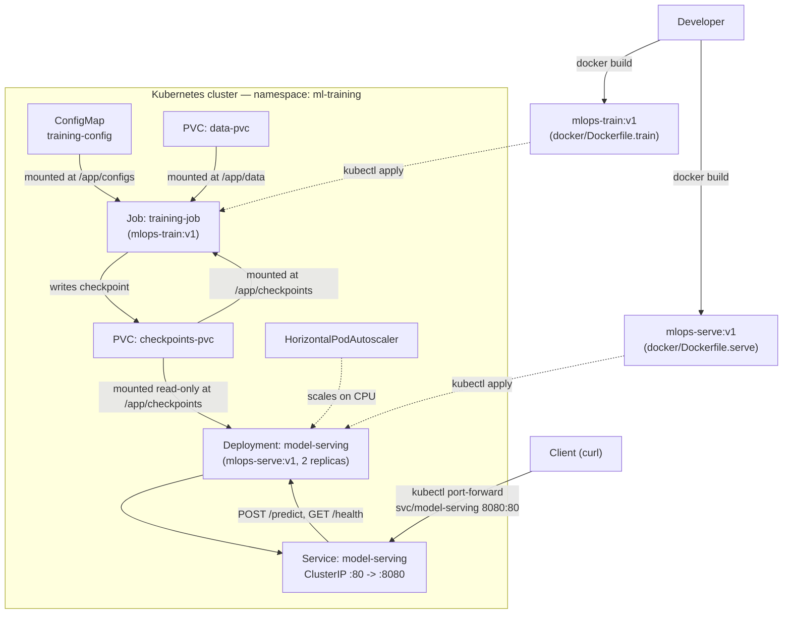

# mlops-pytorch-pipeline

A Fashion-MNIST image classifier taken through the full MLOps lifecycle: a PyTorch CNN trained and served behind a FastAPI app, both packaged as Docker images, and deployed to Kubernetes as a training `Job` and an autoscaled serving `Deployment`.

## Note:
The following files were created but left empty as there were no instructions to fill them in the assignment:

1) `tests/test_model.py`
2) `.github/workflows/ci.yml`
3) `k8s/hpa.yaml`

The folllowing files were created to better meet the goals of the assignment even though they were not explicitly mentioned:

1) `k8s/training-gpu-job.yaml` - a GPU-enabled version of the training job manifest, with the bonus `GPU resource requests (nvidia.com/gpu: 1) ` and a `nodeSelector` for adding node affinities for a GPU node. The original `k8s/training-job.yaml` assumed CPU-only nodes.
2) `k8s/pvc.yaml` - a manifest for creating the PersistentVolumeClaims used for storing training data and model checkpoints. This was not explicitly mentioned in the assignment, but is necessary for the pipeline to work correctly.

## Architecture

*The architecture diagram and the setup instructions below were generated with AI assistance (Claude).*



Locally (outside Kubernetes), the same two images can be run directly with `docker run`, bind-mounting `data/`, `checkpoints/`, and optionally `configs/` from the host in place of the ConfigMap/PVC volumes.

## Prerequisites

- Python 3.14.6
- Docker Desktop (or another Docker-enabled engine)
- `kubectl`
    ```
    Client Version: v1.36.3
    Kustomize Version: v5.8.1
    ```
- A local Kubernetes cluster
- `curl`

## Setup

### 1. Local Python environment (optional, for running/editing outside Docker)

```bash
python -m venv .venv && source .venv/bin/activate
pip install -r requirements/train.txt
pip install -r requirements/serve.txt
```

### 2. Build and run with Docker

```bash
# Train
docker build -f docker/Dockerfile.train -t mlops-train:v1 .
docker run --rm \
  -v $(pwd)/data:/app/data \
  -v $(pwd)/checkpoints:/app/checkpoints \
  mlops-train:v1

# Serve
docker build -f docker/Dockerfile.serve -t mlops-serve:v1 .
docker run --rm -p 8080:8080 \
  -v $(pwd)/checkpoints:/app/checkpoints \
  mlops-serve:v1

# Test
curl http://localhost:8080/health
curl -X POST http://localhost:8080/predict -F "image=@test_image.png"
```

Training reads `configs/training_config.yaml` by default (baked into the image). Point it elsewhere without rebuilding via either a bind mount or the `CONFIG_PATH` env var:

```bash
docker run --rm \
  -v $(pwd)/data:/app/data \
  -v $(pwd)/checkpoints:/app/checkpoints \
  -v $(pwd)/configs:/app/configs:ro \
  mlops-train:v1

# or
docker run --rm \
  -v $(pwd)/data:/app/data \
  -v $(pwd)/checkpoints:/app/checkpoints \
  -e CONFIG_PATH=/app/configs/training_config.yaml \
  mlops-train:v1
```

### 3. Deploy to Kubernetes

Load both images into your cluster's node first (Minikube example — use `kind load docker-image` on kind):

```bash
minikube image load mlops-train:v1
minikube image load mlops-serve:v1
```

Apply the manifests:

```bash
kubectl apply -f k8s/namespace.yaml
kubectl apply -f k8s/configmap.yaml
kubectl apply -f k8s/pvc.yaml
kubectl apply -f k8s/training-job.yaml

# Wait for the training Job to complete
kubectl get pods -n ml-training -w

kubectl apply -f k8s/serving-deployment.yaml
kubectl apply -f k8s/serving-service.yaml
kubectl apply -f k8s/hpa.yaml
```

Verify and test:

```bash
kubectl get pods -n ml-training
kubectl describe deployment model-serving -n ml-training

kubectl port-forward svc/model-serving 8080:80 -n ml-training
curl -X POST http://localhost:8080/predict -F "image=@test_image.png"
```

> Editing `k8s/training-job.yaml` after the Job has already been applied once? Its pod template is immutable — run `kubectl delete job training-job -n ml-training` before re-applying.

## Reflection

### What was the most challenging part?


I found it challenging to work with Kubernetes locally and to make sure every resource (Namespace, ConfigMap, Job, Deployment, Service, PVC) was created in the correct namespace and actually wired to the right one — a lot of the errors I hit came down to a manifest quietly defaulting to the wrong namespace or referencing a PersistentVolumeClaim that didn't exist yet. I spent quite some time debugging issues that now seem silly in hindsight. I also struggled with loading the trained PyTorch model in the serving app: my training script saved a full checkpoint dictionary (model weights plus optimizer state, epoch, and metrics) rather than just the raw weights, so a plain `load_state_dict` call failed until I understood I needed to unwrap the `model_state_dict` key first. Another issue I ran into was preparing the local `test_image.png` for inference — it had to be resized to `28x28` and converted to a single-channel grayscale image to match what the model was trained on. These are all very new things for me and were surprisingly tricky to get right.

I also spent a fair amount of time getting the train and serve Dockerfiles to actually share their build cache. Initially each Dockerfile reinstalled torch/torchvision through slightly different `requirements` files and setup steps, so Docker correctly treated them as different layers and reinstalled the same multi-gigabyte dependencies twice on every rebuild. Extracting a shared `requirements/base.txt` and making both Dockerfiles' base stage byte-identical let Docker's cache recognize the layer as genuinely reusable, so the expensive install only runs once across both images.

Last but not least, coming up with an appropriate CNN was also tricky, though I had a lot of help from documentation and material from a course I took last term. I did not do much hyperparameter tuning, since the focus of this assignment was on getting the build and serve pipelines working end to end rather than squeezing out model accuracy.